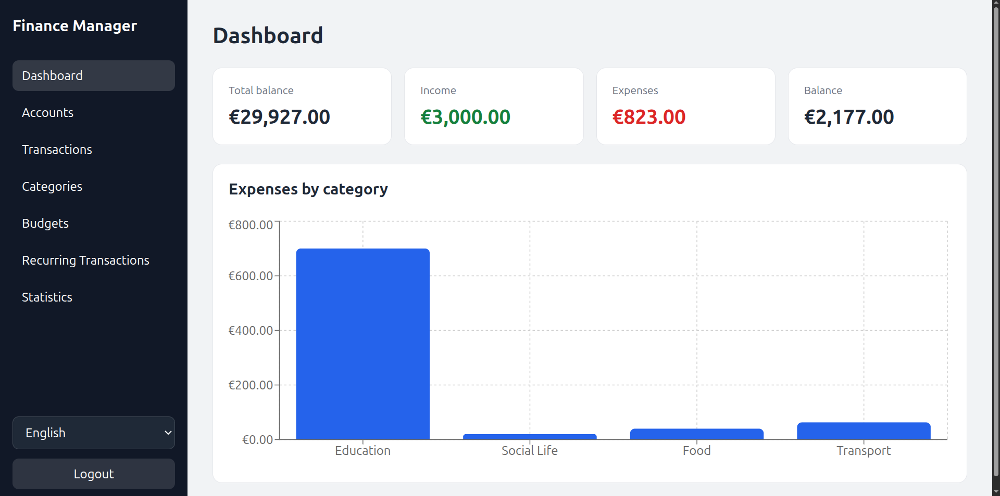
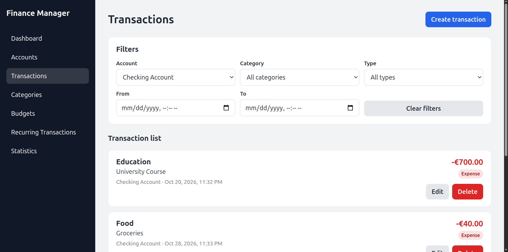
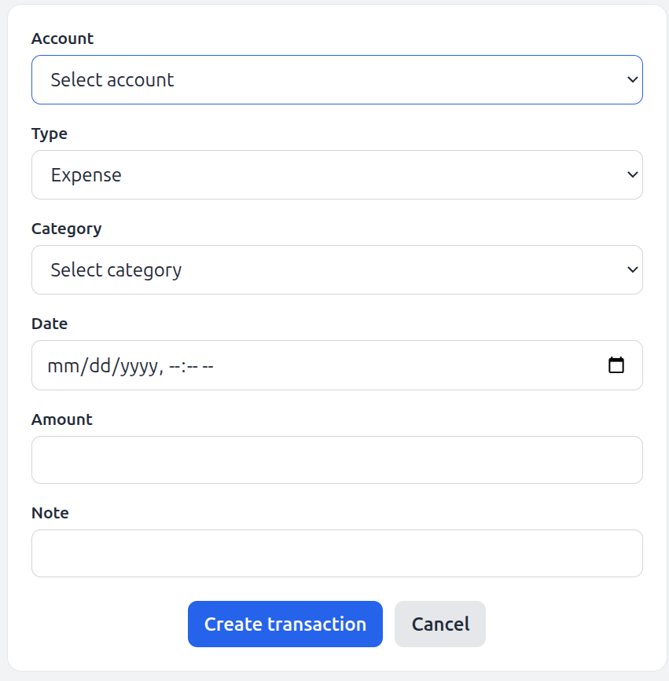
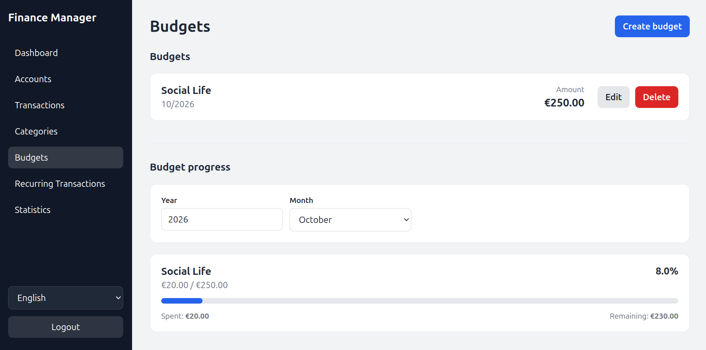
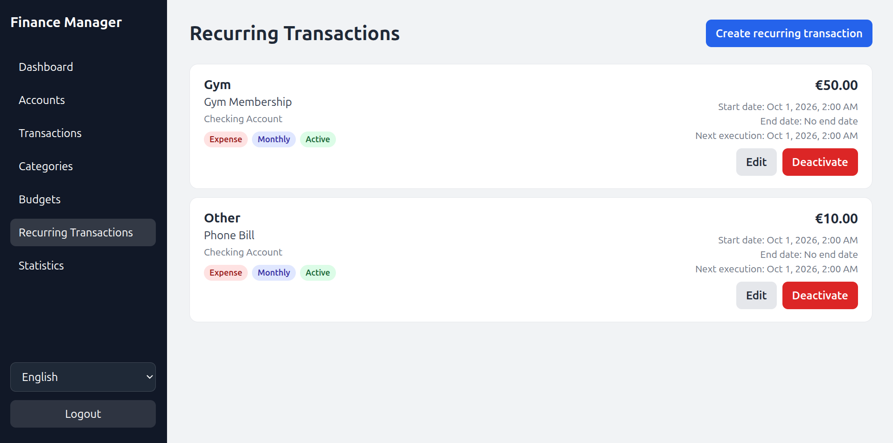
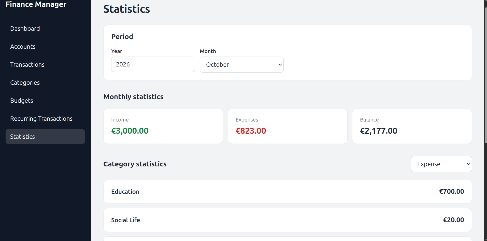
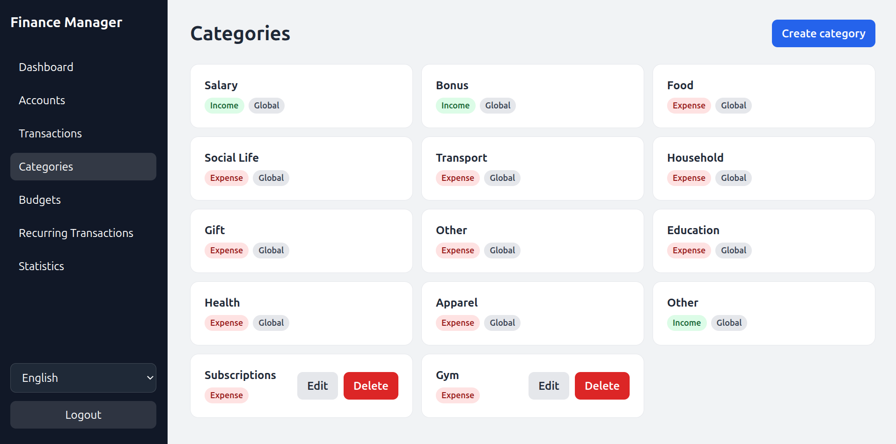

# Finance Manager

A full-stack personal finance application for managing accounts, transactions, budgets, recurring transactions, categories, and monthly statistics.

The project was built as a learning and portfolio project with a focus on backend architecture, authentication, frontend state management, API integration, and containerized deployment.

## Features

- User registration and login
- JWT access-token authentication
- Refresh-token based session restoration
- Account management
- Income and expense transactions
- Transaction filtering by account, category, type, and date
- Global and user-defined categories
- Monthly budgets and budget progress tracking
- Recurring transactions
- Monthly income, expense, and balance statistics
- Expense statistics by category
- Dashboard with account balance summaries and category charts
- English and German localization
- Dockerized frontend, backend, and PostgreSQL database

## Tech Stack

### Backend

- Java 21
- Spring Boot
- Spring Security
- Spring Data JPA
- PostgreSQL
- JWT authentication
- Maven

### Frontend

- React
- TypeScript
- Vite
- React Context
- i18next / react-i18next
- Recharts
- Fetch API

### Infrastructure

- Docker
- Docker Compose
- Nginx

## Architecture

The application is structured as a full-stack system with three main services:

```text
Browser
   |
   v
React / TypeScript frontend
   |
   | HTTP / JSON
   v
Spring Boot REST API
   |
   v
PostgreSQL
```

The complete application can be started with Docker Compose.

```text
Docker Compose
├── frontend
│   └── React build served by Nginx
├── backend
│   └── Spring Boot application
└── postgres
    └── PostgreSQL database
```

The frontend uses shared application state where multiple features require the same data, while feature-specific UI state remains local to individual components.

Authentication-related functionality is provided through a React Context so protected API requests can share the same authentication and token-refresh behavior.

## Authentication

The application uses an access-token and refresh-token authentication flow.

After login:

1. The backend returns an access token and refresh token.
2. The access token is used for protected API requests.
3. The refresh token is stored locally so a session can be restored after a page reload.
4. If an API request returns `401 Unauthorized`, the frontend attempts to obtain a new access token.
5. The original request is retried with the refreshed access token.
6. If refreshing fails, the local session is cleared.

Protected backend endpoints determine the current user from the authenticated request rather than accepting a user ID from the frontend.

## Screenshots

### Dashboard

The dashboard provides an overview of total balance, current-month income and expenses, and spending grouped by category.



### Transactions

Transactions can be created, edited, deleted, and filtered by account, category, type, and date.



### Transaction Creation



### Budgets

Monthly budgets can be created for expense categories and compared with actual spending.



### Recurring Transactions

Recurring transactions support configurable frequencies and active/inactive states.



### Statistics

Monthly financial statistics and category spending can be inspected for a selected period.



### Categories

The application contains global categories and also allows users to manage their own custom categories.



## Running the Application

### Requirements

You only need:

- Docker
- Docker Compose

Java, Maven, Node.js, PostgreSQL, and Nginx do not need to be installed locally when running the complete application through Docker.

### 1. Clone the repository

```bash
git clone https://github.com/Meja01/finance-app
cd FinanceApp
```

### 2. Configure environment variables

Copy the example environment file:

```bash
cp .env.example .env
```

Then provide appropriate values in `.env`.

Example:

```env
DB_USERNAME=finance_user
DB_PASSWORD=change-me
DB_NAME=finance

JWT_SECRET=replace-with-a-secure-secret-of-at-least-32-characters
JWT_EXPIRATION=900000
REFRESH_TOKEN_EXPIRATION_DAYS=30

VITE_API_URL=http://localhost:8080
```

Do not commit the real `.env` file.

### 3. Start the application

```bash
docker compose up --build
```

The services will be available at:

```text
Frontend: http://localhost:5173
Backend:  http://localhost:8080
Database: localhost:5432
```

To stop the application:

```bash
docker compose down
```

Database data is persisted using a Docker volume.

## Local Development

The frontend can also be run separately during development:

```bash
cd frontend
npm install
npm run dev
```

For local frontend development, configure:

```env
VITE_API_URL=http://localhost:8080
```

in `frontend/.env.local`.

The backend can be run with Maven while PostgreSQL is running through Docker.

## Configuration

The Spring Boot application reads configuration from environment variables.

Important variables include:

```text
DB_URL
DB_USERNAME
DB_PASSWORD
JWT_SECRET
JWT_EXPIRATION
REFRESH_TOKEN_EXPIRATION_DAYS
```

Frontend API configuration is supplied through:

```text
VITE_API_URL
```

`VITE_*` values are included in the frontend build and therefore must not contain secrets.

## Project Structure

```text
FinanceApp/
├── src/                    # Spring Boot backend
├── frontend/               # React / TypeScript frontend
├── Dockerfile              # Backend Docker image
├── docker-compose.yaml
├── pom.xml
├── .env.example
└── .dockerignore
```

The frontend is further organized into feature-oriented component areas such as:

```text
components/
├── Accounts/
├── Auth/
├── Budgets/
├── Categories/
├── Dashboard/
├── RecurringTransactionSection/
├── Stats/
└── TransactionSection/
```

## What I Practiced

This project was developed primarily to strengthen practical full-stack development skills, including:

- designing REST APIs with Spring Boot
- structuring a modular backend
- implementing authentication with access and refresh tokens
- protecting user-specific resources
- connecting React state to REST APIs
- deciding between local and shared frontend state
- handling loading, error, and empty states
- building reusable React components
- internationalizing a React application
- visualizing financial data
- externalizing configuration and secrets
- containerizing a multi-service application with Docker Compose

## Future Improvements

Planned improvements include:

- stronger backend request validation
- more consistent API error responses
- additional automated backend tests
- frontend and backend test coverage
- CI/CD pipeline
- production deployment
- additional dashboard visualizations
- further responsive/mobile improvements
- accessibility improvements

## Disclaimer

All data shown in the screenshots is fictional demo data created for demonstration purposes.
